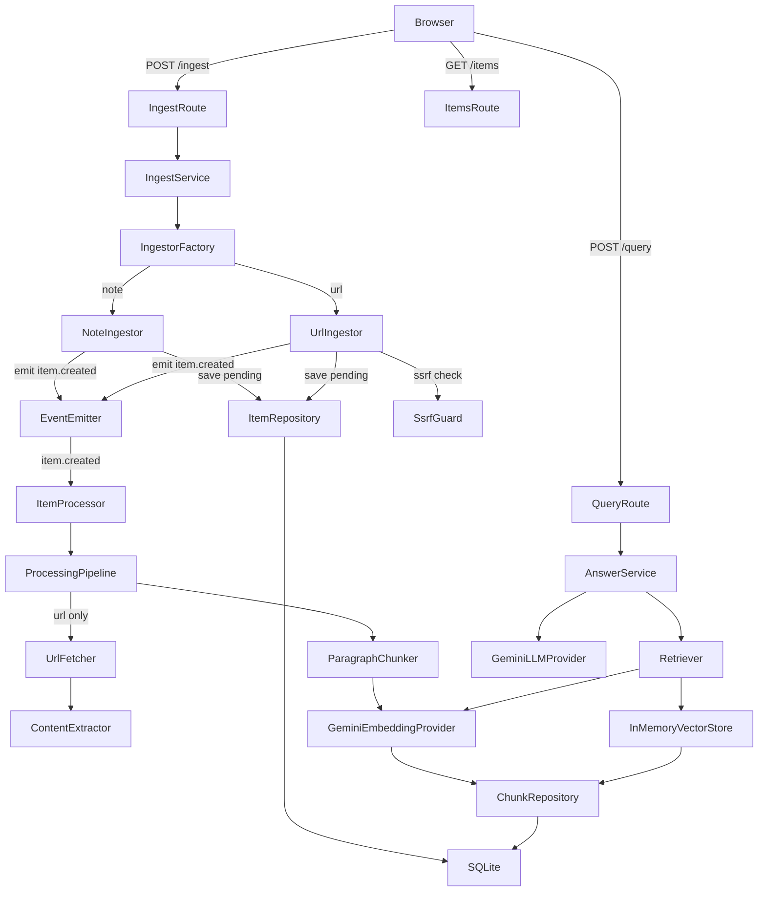

# AI Knowledge Inbox

A minimal single-user web app for saving notes and URLs, then asking questions about them. An AI pipeline embeds your content, retrieves the most relevant chunks, and generates answers with numbered inline citations — so you always know where the answer came from.

---

## Table of Contents

1. [Overview](#1-overview)
2. [Quick Start](#2-quick-start)
3. [Architecture](#3-architecture)
4. [API Reference](#4-api-reference)
5. [Design Decisions & Patterns](#5-design-decisions--patterns)
6. [Tradeoffs](#6-tradeoffs)
7. [What Breaks at Scale](#7-what-breaks-at-scale)
8. [What I Would Change for Production](#8-what-i-would-change-for-production)
9. [Debugging Guide](#9-debugging-guide)
10. [Known Limitations](#10-known-limitations)
11. [How AI Assisted](#11-how-ai-assisted)

---

## 1. Overview

AI Knowledge Inbox is a RAG (retrieval-augmented generation) app with a single purpose: save information, ask questions, get grounded answers.

**Save a note** → it is chunked, embedded, and stored.  
**Save a URL** → the page is fetched, extracted via Readability, chunked, embedded, and stored — asynchronously, while you continue using the app.  
**Ask a question** → the question is embedded, the most similar chunks are retrieved, a prompt is built with numbered context blocks, and Gemini generates an answer with `[n]` citations that map to visible source cards.

No auth. No multi-tenancy. No infrastructure theater. Built to be read as much as run.

---

## 2. Quick Start

### Prerequisites

- Node.js ≥ 20
- A Gemini API key — get one free at [aistudio.google.com/apikey](https://aistudio.google.com/apikey)

### Install

```bash
git clone <repo-url>
cd ai-knowledge-inbox

# Install server dependencies
cd server && npm install

# Install web dependencies
cd ../web && npm install
```

### Environment setup

```bash
cp server/.env.example server/.env
```

Open `server/.env` and set your key:

```
GEMINI_API_KEY=your_key_here
```

All other values have sensible defaults. The full reference:

```env
PORT=4000                          # HTTP server port
GEMINI_API_KEY=                    # Required — Gemini API key
EMBEDDING_MODEL=gemini-embedding-001  # Gemini embedding model
CHAT_MODEL=gemini-2.5-flash        # Gemini chat model
DATABASE_PATH=./data/inbox.db      # SQLite file location
LOG_LEVEL=info                     # trace | debug | info | warn | error
URL_FETCH_TIMEOUT_MS=10000         # Timeout for URL fetching
URL_MAX_BYTES=2000000              # Max response size for URL fetching (2 MB)
RETRIEVAL_TOP_K=5                  # Max chunks returned per query
MIN_SIMILARITY_SCORE=0.2           # Minimum cosine similarity threshold
CORS_ORIGIN=http://localhost:5173  # Allowed CORS origin for the frontend
```

### Run

In two separate terminals:

```bash
# Terminal 1 — backend
cd server && npm run dev
# Server starts on http://localhost:4000

# Terminal 2 — frontend
cd web && npm run dev
# App opens at http://localhost:5173
```

### Run tests

```bash
cd server && npm test
# 59 tests across 5 suites — no API key required
```

### Build for production

```bash
cd server && npm run build   # compiles to server/dist/
cd web && npm run build      # bundles to web/dist/
```

---

## 3. Architecture

### Layers and flow

```
Browser (React)
    │  POST /ingest   GET /items   POST /query
    ▼
Express routes  →  Middleware (validate, rate-limit, log)
    │
    ▼
Services (single composition root: container.ts)
    │
    ├── Ingest path
    │     NoteIngestor ──────────────────────────────┐
    │     UrlIngestor → ssrfGuard → UrlFetcher        │
    │                 → ContentExtractor              │  item.created event
    │                                                 ▼
    │     ItemProcessor ← appEvents ←────────── ProcessingPipeline
    │                                   ParagraphChunker → GeminiEmbeddingProvider
    │                                                 │
    │                                         SqliteChunkRepository
    │
    └── Query path
          Retriever → GeminiEmbeddingProvider (embed question)
                    → InMemoryVectorStore (cosine similarity scan)
                    → AnswerService → promptBuilder → GeminiLLMProvider
                    → Source mapping with [n] citation indices
    │
    ▼
SQLite (better-sqlite3)
  items table    — metadata, status, raw content
  chunks table   — text + Float32 embedding BLOB
```

### Mermaid diagram



---

## 4. API Reference

All responses are JSON. All errors use this shape:

```json
{
  "error": {
    "code": "ERROR_CODE",
    "message": "Human readable message",
    "details": [{ "field": "fieldName", "message": "reason" }]
  }
}
```

Every response includes an `x-request-id` header. Pass it when reporting bugs — it correlates the request to all server log lines.

### `POST /ingest`

Save a note or URL.

**Request:**
```json
{ "type": "note" | "url", "content": "string" }
```

- `note`: plain text, 1–20,000 characters
- `url`: valid `http`/`https` URL, max 2,048 characters

**Response — note (`201 Created`):**
```json
{
  "item": {
    "id": "uuid",
    "sourceType": "note",
    "url": null,
    "title": null,
    "rawContent": "your note text",
    "status": "pending",
    "error": null,
    "createdAt": "2026-10-15T12:00:00.000Z"
  }
}
```

**Response — URL (`202 Accepted`):**
```json
{
  "item": {
    "id": "uuid",
    "sourceType": "url",
    "url": "https://example.com",
    "title": null,
    "rawContent": null,
    "status": "pending",
    "error": null,
    "createdAt": "2026-10-15T12:00:00.000Z"
  }
}
```

The item transitions to `ready` (or `failed`) asynchronously. Poll `GET /items` to observe the change.

**Errors:** `400` invalid input · `413` body too large · `422` SSRF-blocked URL · `429` rate limit · `502` Gemini embedding failure

---

### `GET /items`

List all saved items, newest first.

**Response (`200 OK`):**
```json
{
  "items": [
    {
      "id": "uuid",
      "sourceType": "note",
      "url": null,
      "title": null,
      "preview": "First 200 chars of content…",
      "status": "ready",
      "error": null,
      "createdAt": "2026-10-15T12:00:00.000Z",
      "chunkCount": 3
    }
  ]
}
```

`preview` is the first 200 characters of content. Full `rawContent` is never returned here.

---

### `POST /query`

Ask a question over all saved content.

**Request:**
```json
{ "question": "What is the speed of light?" }
```

3–1,000 characters, trimmed.

**Response (`200 OK`) — answer found:**
```json
{
  "answer": "The speed of light in a vacuum is 299,792,458 m/s [1].",
  "sources": [
    {
      "index": 1,
      "itemId": "uuid",
      "chunkId": "uuid",
      "title": "Physics Notes",
      "url": null,
      "snippet": "The speed of light in a vacuum is exactly 299,792,458 metres per second…",
      "score": 0.83
    }
  ]
}
```

**Response (`200 OK`) — no relevant context:**
```json
{
  "answer": "The saved content does not contain enough information to answer this question.",
  "sources": []
}
```

When `sources` is empty, the LLM was **not** called — the response is a static string. No hallucination possible in that path.

**Errors:** `400` invalid input · `429` rate limit · `502` Gemini embedding/LLM failure

---

### Status codes

| Code | Meaning |
|------|---------|
| `200` | OK |
| `201` | Note created |
| `202` | URL accepted for async processing |
| `400` | Invalid input (validation error or malformed JSON) |
| `404` | Unknown route |
| `413` | Request body too large |
| `422` | Valid request, content unprocessable (e.g. SSRF-blocked URL, unreadable page) |
| `429` | Rate limit exceeded |
| `500` | Unexpected server error |
| `502` | Upstream Gemini API failure |

---

## 5. Design Decisions & Patterns

### SOLID in practice

| Principle | Implementation |
|-----------|---------------|
| **Single Responsibility** | Each module has one job: `ParagraphChunker` only chunks, `GeminiEmbeddingProvider` only embeds, `Retriever` only retrieves. Route handlers only parse, validate, call a service, and shape a response. |
| **Open/Closed** | Adding a new chunking strategy means adding a class that implements `Chunker` — `ParagraphChunker` is untouched. Adding a new LLM provider means adding a class implementing `LLMProvider`. The `IngestorFactory` switch is the only change needed for a new source type. |
| **Liskov Substitution** | All fake implementations in tests (`FakeEmbeddingProvider`, `FakeLLMProvider`, `FakeChunkRepository`, etc.) satisfy the same interfaces as real implementations and are used interchangeably by callers. |
| **Interface Segregation** | `ItemRepository` only has item methods. `ChunkRepository` only has chunk methods. `VectorStore` only has `search`. No caller depends on methods it doesn't use. |
| **Dependency Inversion** | Services depend on interfaces (`EmbeddingProvider`, `LLMProvider`, `VectorStore`), never on `@google/generative-ai` or `better-sqlite3` directly. All wiring happens in `server/src/container.ts` — the single composition root. |

### Patterns used

| Pattern | Where | Why |
|---------|-------|-----|
| **Strategy** | `ParagraphChunker` implements `Chunker` | Swap chunking algorithm without touching callers |
| **Adapter** | `GeminiEmbeddingProvider`, `GeminiLLMProvider` | Insulate business logic from the Gemini SDK |
| **Repository** | `SqliteItemRepository`, `SqliteChunkRepository` | Centralise all DB access; easy to test with fakes |
| **Factory** | `IngestorFactory` | Decouple ingestor selection from the caller (`IngestService`) |
| **Dependency Injection** | Constructor injection everywhere | Makes dependencies explicit and swappable |
| **Pipeline** | `ProcessingPipeline` | Composable steps: fetch → extract → chunk → embed → store |
| **Observer** | `appEvents` (`EventEmitter`) + `ItemProcessor` | Decouple URL ingestion from background processing |

### Patterns deliberately not used

- **Decorator** — no cross-cutting concerns complex enough to justify it; middleware handles logging/validation.
- **Command/CQRS** — three endpoints, one writer; the overhead would exceed the benefit.
- **Abstract Factory** — `IngestorFactory` is already a simple factory; no family of related objects to create.

---

## 6. Tradeoffs

### Chunking: paragraph-first with overlap

**Why paragraph-first over fixed-size:** Fixed-size windows cut mid-sentence, destroying semantic coherence. Paragraphs are natural topic boundaries in prose and notes — splitting on them keeps each chunk thematically meaningful. Sentence-level fallback handles dense paragraphs that would exceed the token budget.

**Why overlap (~250 chars, ~12.5%):** A sentence that spans a chunk boundary would otherwise lose context on either side. The overlap ensures that context is preserved across boundaries without duplicating large amounts of text.

**Limits:** The chunker has no heading awareness (it treats `# Section` as a paragraph), no semantic understanding, and no language-specific sentence detection. A long list of bullet points becomes one chunk even if it covers multiple topics.

**What to try next:** Heading-aware splitting (detect markdown or HTML headings and treat them as hard boundaries), or a semantic chunker that uses embeddings to detect topic shifts.

---

### Vector store: SQLite + in-memory cosine

**Why not a vector DB:** At single-user scale (hundreds to low-thousands of chunks), a linear scan over normalised Float32 vectors in memory is fast (< 10 ms), requires no additional infrastructure, and is trivially correct. The `VectorStore` interface means replacing it with pgvector or Qdrant only requires adding a new implementation — callers are unaffected.

**Why normalise on write:** Storing unit-length vectors means cosine similarity reduces to a dot product at query time — one multiply-accumulate loop instead of two magnitude calculations. Cheaper at every query.

**Why BLOB in SQLite:** Keeps the stack minimal. SQLite handles the persistence; the memory scan handles the math. No separate process, no network hop, no operational complexity.

---

### Async processing for URLs

**Why in-process event-driven:** URL fetching is I/O-bound and can take several seconds. Blocking the HTTP response would degrade UX. The Observer pattern (emit `item.created`, `ItemProcessor` handles it) decouples the API layer from the background work with no queue infrastructure.

**The honest tradeoff:** If the process crashes while processing a URL, the item stays `pending` forever. There are no retries, no dead-letter queue, no durability. For a single-user prototype this is acceptable — you can re-submit the URL.

---

### Embedding and LLM choices

**Embedding model (`gemini-embedding-001`):** Google's GA embedding model. Produces 768-dimensional vectors. Good quality/cost ratio. Changed from `text-embedding-004` (pre-GA, no longer available) during development.

**Chat model (`gemini-2.5-flash`):** Fast, cheap, good instruction-following. Temperature set to 0.2 to keep answers grounded in context. Configurable via `CHAT_MODEL` env var — swap to `gemini-2.5-pro` for higher quality without code changes.

---

## 7. What Breaks at Scale

| Problem | Why it breaks |
|---------|--------------|
| **Linear vector scan** | `findAllReady()` loads all chunk embeddings into memory on every query. At tens of thousands of chunks this becomes slow and memory-hungry. |
| **Memory growth** | Embeddings live in SQLite but are loaded into Node.js heap on each query. 10,000 chunks × 768 floats × 4 bytes = ~30 MB per query — manageable now, not at 100k chunks. |
| **In-process background work** | `ItemProcessor` runs in the same process as the API. A crash, OOM, or deployment loses all in-flight URL jobs. No retry, no durability, no observability into the queue depth. |
| **No deduplication** | Submitting the same URL twice creates two items with near-identical content, wasting embeddings and diluting retrieval quality. |
| **Re-embedding cost on model change** | Switching embedding models invalidates all stored vectors. There is no versioning or re-index job — you would need to delete all chunks and reprocess every item. |
| **SQLite single-writer** | SQLite's WAL mode handles concurrent reads well, but a second writer (e.g. a background job process) would contend or error. |
| **No rate limiting by user** | The current rate limiter is keyed by IP. Multi-user or proxy scenarios would need per-user token-bucket limiting. |
| **No content size limits on notes** | A 20,000-character note produces many chunks and one large embedding batch call — no protection against notes designed to exhaust token quotas. |

---

## 8. What I Would Change for Production

| Area | Change |
|------|--------|
| **Vector store** | Replace `InMemoryVectorStore` with a pgvector extension on PostgreSQL or a managed Qdrant instance. The `VectorStore` interface makes this a drop-in swap. |
| **Job queue** | Replace `ItemProcessor` with BullMQ (Redis-backed). Gives retries, dead-letter queues, job deduplication, concurrency control, and a UI for monitoring stuck jobs. |
| **Auth** | Add JWT or session-based auth with per-user data isolation. Items and chunks need a `user_id` foreign key. |
| **Rate limiting** | Per-user token-bucket rate limiting with Redis; quotas on embedding tokens and LLM tokens per day. |
| **Embedding versioning** | Store the `embeddingModel` name on each chunk. A background migration job re-embeds chunks when the model changes instead of invalidating the whole corpus. |
| **Content dedup** | Hash `rawContent` before ingesting; skip if already present. Saves embedding cost and keeps retrieval clean. |
| **Hybrid search** | BM25 (keyword) + vector (semantic) retrieval, re-ranked with a cross-encoder. Better recall on exact-match queries that low cosine similarity would miss. |
| **Observability** | Structured metrics (Prometheus/OpenTelemetry), distributed tracing (request IDs are already propagated), alerting on embedding/LLM error rates and latency percentiles. |
| **Streaming answers** | Stream the LLM response to the browser via SSE or chunked transfer. Reduces perceived latency for long answers. |
| **Secrets management** | Move API keys out of `.env` files into a secrets manager (AWS Secrets Manager, HashiCorp Vault). Never commit `.env` to version control. |
| **CI/CD** | TypeScript compile check + test suite on every PR. Separate staging environment. Database migrations with a proper migration runner (e.g. Flyway or `node-pg-migrate`). |

---

## 9. Debugging Guide

### Reading the logs

The server emits structured JSON logs. Each line is a complete event with a timestamp, level, and contextual fields. Pipe through `jq` for readability:

```bash
cd server && npm run dev | jq .
```

Key log events and what they mean:

| `msg` field | What it tells you |
|-------------|-------------------|
| `"Server started"` | App booted successfully; `port` field confirms which port |
| `"Schema migration applied"` | SQLite DB opened and schema is current |
| `"ItemProcessor: listening for item.created events"` | Background processor is ready |
| `"Pipeline: starting"` | An item has started processing; `itemId` and `sourceType` fields identify it |
| `"Pipeline: chunked"` | Chunking complete; `chunkCount` and `durationMs` show how many chunks and how long |
| `"Pipeline: embedded"` | Embedding complete; `batchSize` and `durationMs` |
| `"Pipeline: complete, item ready"` | Processing succeeded |
| `"Pipeline: failed"` | Processing failed; `err` field has the cause; `itemId` identifies the item |
| `"Retriever: search complete"` | Shows `topScores`, `aboveThreshold`, `minScore` — tells you if retrieval is finding relevant content |
| `"LLM: generation complete"` | Shows `promptTokens`, `candidateTokens`, `totalTokens`, `durationMs` |
| `"Unhandled error"` | Unexpected 500 — `err.stack` has the full trace |

### Using request IDs

Every request gets an `x-request-id` UUID header (generated if not provided by the client). It appears in every log line for that request's lifecycle — including background pipeline logs triggered by that request.

```bash
# Find all log lines for a specific request
cd server && npm run dev 2>&1 | jq 'select(.reqId == "your-request-id-here")'
```

### Common failure causes

| Symptom | Likely cause | Fix |
|---------|-------------|-----|
| Server won't start, `Configuration error: GEMINI_API_KEY is required` | `server/.env` missing or key not set | Copy `.env.example`, add your key |
| Note stays `pending` forever | Gemini embedding API error (check logs for `Pipeline: failed`) | Check API key, quota, and network access |
| URL stays `pending`, then `failed` with "Cannot resolve hostname" | DNS failure or private IP rejected by SSRF guard | Use a public URL; check network connectivity |
| URL fails with "Unsupported content type" | Page returns `application/json` or `application/pdf` instead of HTML | Only `text/html` and `text/plain` are supported |
| Query returns "not enough information" for a related question | Similarity score below `MIN_SIMILARITY_SCORE=0.2` | Lower the threshold in `.env`, or check the item processed successfully (chunkCount > 0) |
| `502` on query | Gemini API key exhausted, rate-limited, or model unavailable | Check Gemini console; `CHAT_MODEL` env var |
| Frontend shows "Failed to load items" | Backend not running or CORS mismatch | Ensure server is on port 4000; check `CORS_ORIGIN` matches the dev server URL |

---

## 10. Known Limitations

- **Single user, no auth.** All items are shared. Do not deploy publicly without adding authentication.
- **In-process URL processing.** A server restart while a URL is being processed leaves the item stuck as `pending`. Re-submit it manually.
- **No retry on failed items.** Once an item is `failed`, the only recovery is to delete it from SQLite and re-ingest.
- **Linear scan over all vectors.** Performance degrades as the number of ready chunks grows. Practical limit is a few thousand chunks on a single machine.
- **Context window limits.** The top-K chunks are injected into the LLM prompt. With `RETRIEVAL_TOP_K=5` and chunks of ~500 tokens each, the prompt is ~2,500 tokens of context — well within Gemini Flash limits, but large notes or high K values could approach limits.
- **No streaming.** Answers are returned in one HTTP response. Long answers have higher perceived latency.
- **Plain text extraction only.** PDFs, Word documents, images, and paywalled pages are not supported.
- **English-optimised chunking.** Sentence boundary detection relies on `.!?` punctuation — less accurate for CJK languages.

---

## 11. How AI Assisted

This project was built with [Kiro](https://kiro.dev), an AI-powered development environment, acting as the primary code author across all 11 phases.

**What the AI did:**
- Generated all TypeScript source files, tests, configuration, and this README
- Debugged type errors (e.g. `exactOptionalPropertyTypes` edge cases with pino and the error handler)
- Identified and corrected Gemini model names that changed between the spec being written and the current API (`text-embedding-004` → `gemini-embedding-001`, `gemini-1.5-flash` → `gemini-2.5-flash`)
- Verified each phase's acceptance criteria with live curl tests before reporting completion

**What was reviewed manually:**
- Every phase report and suggested commit message before committing
- The SSRF guard IP range coverage (confirmed against RFC 1918, RFC 3927, RFC 4193)
- The prompt design — the no-fabrication and citation instructions were reviewed to ensure they are unambiguous
- This README — each tradeoff section was checked against the actual implementation

**Honest note:** The AI made mistakes that required correction — a regex test bug in the retrieval test, a case-sensitivity mismatch in the prompt builder test, and two Gemini model names that needed updating. These were caught by the test suite and live verification steps embedded in the workflow.
